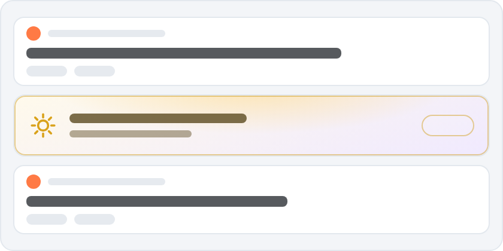
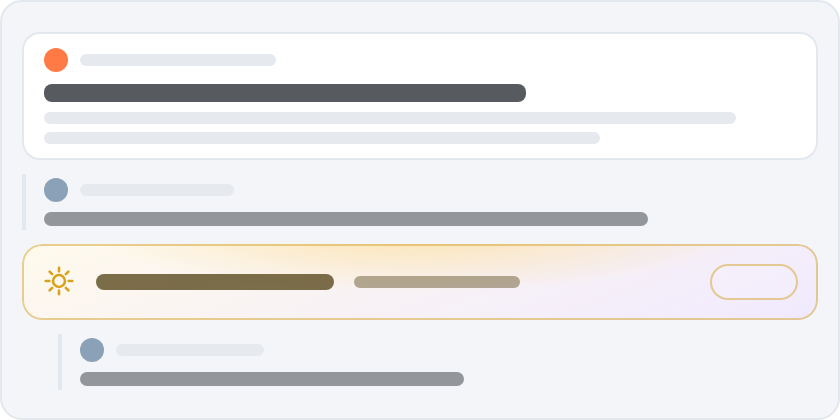
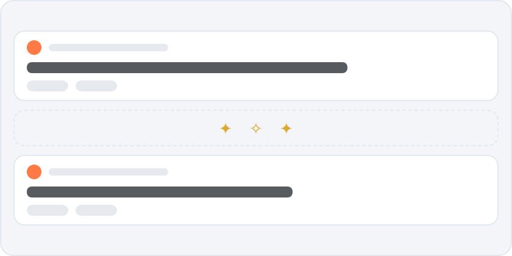
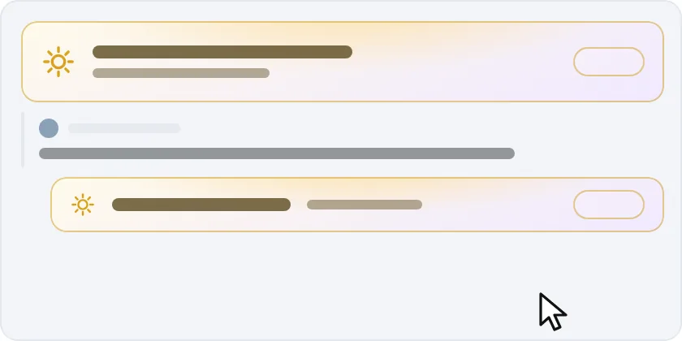
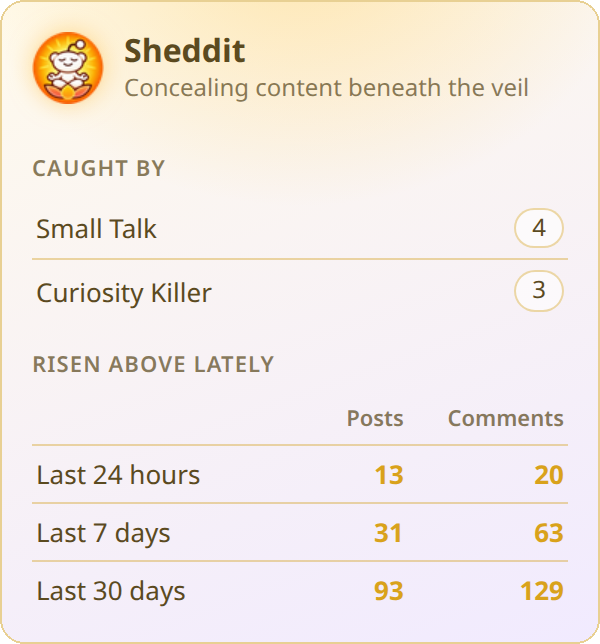
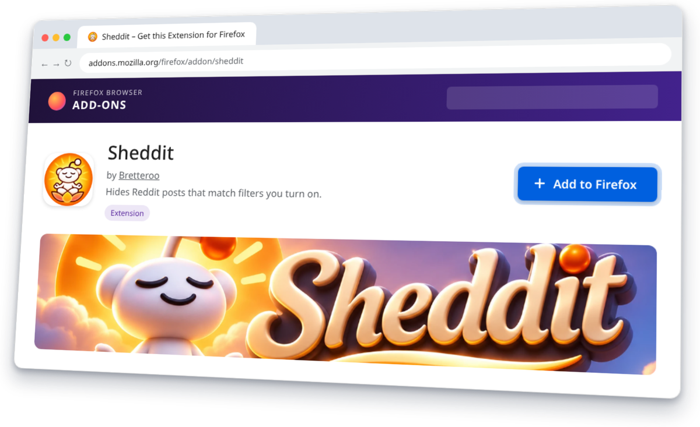
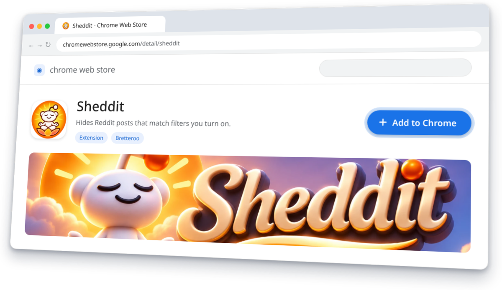

  

  
  
  
  
  
  

---

_The path to enlightenment is lined with hidden posts._

[🪷 Filters](#-filters) | [🪬 How it sees](#-how-it-sees) | [🍃 Letting go](#-letting-go) | [📦 Install](#-install) | [🔒 License](#-license)

---

# Sheddit

If you’ve read the phrase “genuinely curious” one too many times, Sheddit offers a beacon of hope and a path to a more peaceful Reddit experience.

Sheddit is a Firefox and Chrome extension that hides the most repetitive and obnoxious posting habits on Reddit, helping you scroll your way toward enlightenment. By casting off these aggravating parts of the Reddit experience one tired trope at a time, Sheddit lightens your mental load and frees your mind to focus on the conversations worth having.

## 🪷 Filters

Activate one filter for a taste of serenity, or _all of them_ for maximum levels of inner peace.

There is no wrong way to shed content, only fewer posts in your life shaming companies to "do better".

| &nbsp;&nbsp;&nbsp;&nbsp;&nbsp;&nbsp;&nbsp;&nbsp;&nbsp;&nbsp;&nbsp;&nbsp;&nbsp;&nbsp;&nbsp;&nbsp;&nbsp;&nbsp;&nbsp;&nbsp;Filter&nbsp;&nbsp;&nbsp;&nbsp;&nbsp;&nbsp;&nbsp;&nbsp;&nbsp;&nbsp;&nbsp;&nbsp;&nbsp;&nbsp;&nbsp;&nbsp;&nbsp;&nbsp;&nbsp;&nbsp; | Posts and comments that it hides | Default |
| --- | --- | --- |
| &nbsp;&nbsp;Curiosity&nbsp;Killer | "genuinely curious", or "Curious." on its own | On |
| &nbsp;&nbsp;Candor&nbsp;Cutter | "and honestly?" | On |
| &nbsp;&nbsp;Shock&nbsp;Absorber | "what surprised me (the) most" | On |
| &nbsp;&nbsp;Storm&nbsp;Shelter | "blown away" | On |
| &nbsp;&nbsp;Hyperbolic&nbsp;Chamber | "witaf" or "what in the actual fuck" | On |
| &nbsp;&nbsp;Bingo&nbsp;Blackout | "not on my bingo card" | On |
| &nbsp;&nbsp;Sinkhole | "let that sink in" | On |
| &nbsp;&nbsp;Lie&nbsp;Detector | "honest review" | On |
| &nbsp;&nbsp;Sarcasm&nbsp;Sweeper | The "/s" sarcasm tag | On |
| &nbsp;&nbsp;Pity&nbsp;Party | "I don't know why you're getting downvoted" | On |
| &nbsp;&nbsp;Trade&nbsp;Secret | Anyone who is something "by trade" | On |
| &nbsp;&nbsp;Pitchfork&nbsp;Patrol | Scolding like "not a good look" or "do better" | On |
| &nbsp;&nbsp;Case&nbsp;Dismissed | Armchair lawyers asking "Class action lawsuit, anyone?" | On |
| &nbsp;&nbsp;Teachable&nbsp;Moment | "Here's what I learned" and "What I learned about X" | On |
| &nbsp;&nbsp;Catch&nbsp;and&nbsp;Release | 1,000+ characters that end in a question | On |
| &nbsp;&nbsp;Wrecking&nbsp;Ball | 1,000+ characters in a single paragraph | On |
| &nbsp;&nbsp;Lost&nbsp;Blogger | 600+ words | On |
| &nbsp;&nbsp;Inside&nbsp;Voice | Titles in ALL CAPS (8+ capital letters, no lowercase) | On |
| &nbsp;&nbsp;Small&nbsp;Talk | Written without a single capital letter | On |
| &nbsp;&nbsp;My&nbsp;Welcome | "your" where "you're" belongs, like "your welcome" | On |
| &nbsp;&nbsp;Year&#8209;End&nbsp;Clearance | Titles that end in a year, like "Best TV in 2027?" | On |
| &nbsp;&nbsp;Skip&nbsp;Ad | Posts that are just a YouTube link or video, with no text | On |
| &nbsp;&nbsp;Link&nbsp;Dumper | Posts that are just a link to another site, with no text | On |

## 🪬 How it sees

Sheddit dwells only in the present page, hiding or blocking negative energy contained therein.

<table>
<tr>
<td width="50%" valign="top">
<h3>&nbsp;&nbsp;On a listing</h3>

<picture><source media="(prefers-color-scheme: dark)" srcset="https://raw.githubusercontent.com/Bretteroo/Sheddit/main/images/readme/how-listing-dark.png"></picture>

Sheddit contemplates each thread's title.

</td>
<td width="50%" valign="top">
<h3>&nbsp;&nbsp;On an open thread</h3>

<picture><source media="(prefers-color-scheme: dark)" srcset="https://raw.githubusercontent.com/Bretteroo/Sheddit/main/images/readme/how-thread-dark.png"></picture>

Sheddit contemplates the post's title, body, and the comments beneath it.

</td>
</tr>
</table>

Sheddit walks the path on www.reddit.com, old.reddit.com, and Reddit's mobile layout. Your choices rest in your browser's sync storage, and nothing you read is sent anywhere. Enlightenment comes from within...and stays local.

## 🍃 Letting go

When a post _or_ comment is found wanting, Sheddit offers two paths, chosen on its Settings page:

<table>
<tr>
<td width="50%" valign="top">
<h3>&nbsp;&nbsp;Remove it</h3>

<picture><source media="(prefers-color-scheme: dark)" srcset="https://raw.githubusercontent.com/Bretteroo/Sheddit/main/images/readme/let-remove-dark.png"></picture>

Content passes from the page entirely, and you continue as though it had never been. This is the way of non-attachment.  (And the default behavior.)

</td>
<td width="50%" valign="top">
<h3>&nbsp;&nbsp;Hide it</h3>

<picture><source media="(prefers-color-scheme: dark)" srcset="https://raw.githubusercontent.com/Bretteroo/Sheddit/main/images/readme/let-cover-dark.webp"></picture>

Content rests beneath a slim gold veil bearing the name of the filter that caught it. You may peek upon the transgression, should temptation arise, and "Hide" again returns it to the veil.

</td>
</tr>
</table>

<table>
<tr>
<td width="230" valign="top"><picture><source media="(prefers-color-scheme: dark)" srcset="https://raw.githubusercontent.com/Bretteroo/Sheddit/main/images/readme/toolbar-dark.png"></picture></td>
<td valign="top">
<h3>&nbsp;&nbsp;A journey's footprints</h3>

Sheddit's toolbar keeps a modest journal of your ascension, tracing your journey through the passage of time.

It shows how many posts and comments you have risen above, and which filters guided you on your journey toward tranquility.

</td>
</tr>
</table>

## 📦 Install

Firefox users, on desktop and Android, can install Sheddit from [Firefox Add-ons](https://addons.mozilla.org/firefox/addon/shedditfilter/).
 
Chrome, Edge, Brave, Vivaldi, and Opera users can install Sheddit from the [Chrome Web Store](https://chromewebstore.google.com/detail/sheddit/olemfeakjfaeimedbgakkjcdknncpgpf).

### Firefox

<a href="https://addons.mozilla.org/firefox/addon/shedditfilter/"><picture><source media="(prefers-color-scheme: dark)" srcset="https://raw.githubusercontent.com/Bretteroo/Sheddit/main/images/readme/firefox-addons-dark.png"></picture></a>

Open Sheddit on [Firefox Add-ons](https://addons.mozilla.org/firefox/addon/shedditfilter/) and click "Add to Firefox". Firefox for Android installs it from the same page.

Filter settings are under `about:addons`, Sheddit, Preferences.

### Chrome, Edge, Opera, Brave, and Vivaldi

<a href="https://chromewebstore.google.com/detail/sheddit/olemfeakjfaeimedbgakkjcdknncpgpf"><picture><source media="(prefers-color-scheme: dark)" srcset="https://raw.githubusercontent.com/Bretteroo/Sheddit/main/images/readme/chrome-store-dark.png"></picture></a>

Open Sheddit in the [Chrome Web Store](https://chromewebstore.google.com/detail/sheddit/olemfeakjfaeimedbgakkjcdknncpgpf) and click the "Add" or "Get" button.

**Edge** first asks you to click "Allow extensions from other stores" in the banner at the top of the store page.

**Opera** needs its "Install Chrome Extensions" add-on before the store will work.

Manual installation

Manual Installation is generally not necessary.  The Firefox and Chrome extension directories post the latest versions of Sheddit within a few hours (sometimes days) of their release on Github.

**Firefox**

1. Download `sheddit-<version>-firefox.xpi` from the [latest release](https://github.com/Bretteroo/Sheddit/releases/latest).
2. Open `about:debugging#/runtime/this-firefox`.
3. Click "Load Temporary Add-on..." and pick the `.xpi`.

The release `.xpi` isn't signed by Mozilla, so Firefox removes it when it restarts. Firefox Developer Edition and Nightly can keep it installed with `xpinstall.signatures.required` set to false in `about:config`.

**Chrome, Edge, Opera, Brave, and Vivaldi**

1. Download `sheddit-<version>-chrome.zip` and unzip it.
2. Open your browser's extensions page and turn on "Developer mode":
   
   `chrome://extensions`, `edge://extensions`, `opera://extensions`, `brave://extensions` or `vivaldi:extensions`.
3. Click "Load unpacked" and pick the unzipped folder.

## 🔒 License

Sheddit is free software, licensed under the [GNU Affero General Public License, version 3 only](LICENSE) (AGPL-3.0-only).

Sheddit is not affiliated with or endorsed by Reddit, Inc. Reddit is a trademark of Reddit, Inc.
